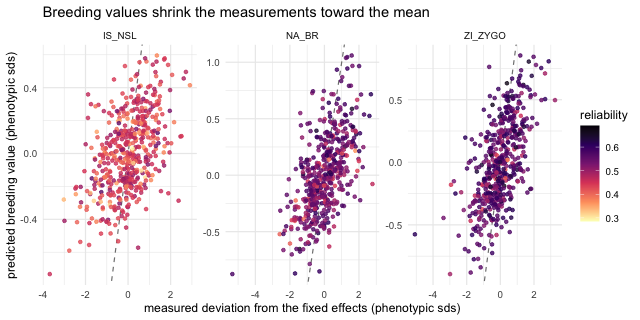

# Breeding values

An animal model answers “how much of the variation in this trait is
additive” and gives the covariance `G`. It does not answer “what is the
additive value of *this* opossum”, because the breeding values are
integrated out of the likelihood: that is what makes the model scale to
many individuals and many traits.
[`breeding_values()`](https://diogro.github.io/stanimal/reference/breeding_values.md)
puts them back afterwards, from the `G`, `E` and `beta` the fit already
estimated. What comes out is what a breeding program would act on: a
predicted additive value per individual, with the reliability of that
prediction.

``` r

library(stanimal)
library(ggplot2)
```

## Fit

Three distances that span the skull and are not dominated by a single
axis.

``` r

traits <- c("IS_NSL", "NA_BR", "ZI_ZYGO")
dat <- opossum[complete.cases(opossum[, c("id", "sex", "age", traits)]), ]
dat[traits] <- log(dat[traits])

design <- suppressWarnings(
  animal_design(cbind(IS_NSL, NA_BR, ZI_ZYGO) ~ sex + age, dat))
A <- opossum_grm[rownames(design$Y), rownames(design$Y)]
fit <- lmm_animal(design$Y, design$X, A, lkj_prior = 2,
                  iter = 800, warmup = 400, chains = 2,
                  refresh = 0, seed = 1)
#> Running MCMC with 2 parallel chains...
#> Chain 2 finished in 3.4 seconds.
#> Chain 1 finished in 3.6 seconds.
#> 
#> Both chains finished successfully.
#> Mean chain execution time: 3.5 seconds.
#> Total execution time: 3.8 seconds.
```

## The breeding values

The prediction is the conditional mean of the additive values given the
data, evaluated at the posterior means of `G`, `E` and `beta`. That is
empirical Bayes: the standard errors are conditional on those values and
do not carry the uncertainty in the covariance parameters.

``` r

ebv <- breeding_values(fit)
ebv
#> <stanimal_breeding_values> 505 individual(s), 3 trait(s), empirical Bayes
#> G, E and beta at their posterior means; reliability is 1 - Var(u | observed y) / (A_nn G_kk)
#>  individual   trait  value    se reliability
#>       K1396  IS_NSL  0.000 0.019       0.374
#>       K1397  IS_NSL -0.027 0.021       0.375
#>       K1408  IS_NSL  0.023 0.019       0.518
#>       K1409  IS_NSL -0.016 0.021       0.521
#>       K1396   NA_BR  0.010 0.025       0.473
#>       K1397   NA_BR  0.043 0.028       0.471
#>       K1408   NA_BR  0.046 0.024       0.612
#>       K1409   NA_BR  0.056 0.027       0.615
#>       K1396 ZI_ZYGO  0.001 0.018       0.500
#>       K1397 ZI_ZYGO -0.018 0.020       0.497
#>       K1408 ZI_ZYGO -0.002 0.017       0.635
#>       K1409 ZI_ZYGO -0.013 0.020       0.639
```

The reliability is the share of a trait’s additive variance the
prediction pins down. An animal with many measured relatives scores
higher than a lone one.

``` r

round(apply(ebv$reliability, 2, stats::quantile, c(0.05, 0.5, 0.95)), 2)
#>     IS_NSL NA_BR ZI_ZYGO
#> 5%    0.36  0.45    0.48
#> 50%   0.44  0.54    0.57
#> 95%   0.51  0.60    0.63
```

The values are on the trait’s scale, as deviations from the fixed
effects, so they can be compared with each animal’s own deviation:

``` r

residual <- design$Y - design$X %*% t(draws_mean(fit, "beta"))
round(diag(stats::cor(ebv$values, residual, method = "spearman")), 2)
#>  IS_NSL   NA_BR ZI_ZYGO 
#>    0.47    0.58    0.60
```

## Ranking candidates

Ranking by breeding value and ranking by measurement do not give the
same list.

``` r

first <- traits[1]
by_value <- rownames(ebv$values)[order(ebv$values[, first], decreasing = TRUE)]
by_phenotype <- rownames(residual)[order(residual[, first], decreasing = TRUE)]
data.frame(id = by_value[1:10],
           value = round(ebv$values[by_value[1:10], first], 3),
           se = round(ebv$se[by_value[1:10], first], 3),
           reliability = round(ebv$reliability[by_value[1:10], first], 3))
#>          id value    se reliability
#> L4741 L4741 0.048 0.021       0.372
#> L4267 L4267 0.046 0.021       0.490
#> L6358 L6358 0.046 0.021       0.442
#> L3715 L3715 0.046 0.020       0.449
#> L3777 L3777 0.045 0.020       0.396
#> L4095 L4095 0.045 0.021       0.472
#> L5470 L5470 0.044 0.019       0.424
#> L5720 L5720 0.043 0.019       0.466
#> L4089 L4089 0.043 0.020       0.430
#> L7487 L7487 0.042 0.021       0.434
length(intersect(by_value[1:10], by_phenotype[1:10]))
#> [1] 0
```

Here 0 of the top ten by breeding value are also in the top ten by their
own measurement. With reliabilities around one half, an animal’s
relatives and its other traits weigh as much in the prediction as its
own record.

## Shrinkage

Every prediction sits closer to the mean than the animal’s own
deviation, and the points furthest inside the line are the ones with the
lowest reliability. Both axes are in phenotypic standard deviations,
since each log distance has its own scale.

``` r

sd_P <- sqrt(diag(draws_mean(fit, "P")))
plot_dat <- data.frame(
  trait = factor(rep(traits, each = nrow(residual)), levels = traits),
  measured = as.numeric(sweep(residual, 2, sd_P, "/")),
  predicted = as.numeric(sweep(ebv$values, 2, sd_P, "/")),
  reliability = as.numeric(ebv$reliability))

ggplot(plot_dat, aes(x = measured, y = predicted, colour = reliability)) +
  geom_abline(slope = 1, intercept = 0, linetype = "dashed", colour = "grey50") +
  geom_point(size = 1.2, alpha = 0.8) +
  scale_colour_viridis_c(option = "magma", direction = -1) +
  facet_wrap(~trait, scales = "free") +
  labs(x = "measured deviation from the fixed effects (phenotypic sds)",
       y = "predicted breeding value (phenotypic sds)",
       title = "Breeding values shrink the measurements toward the mean") +
  theme_minimal()
```



plot of chunk shrinkage
