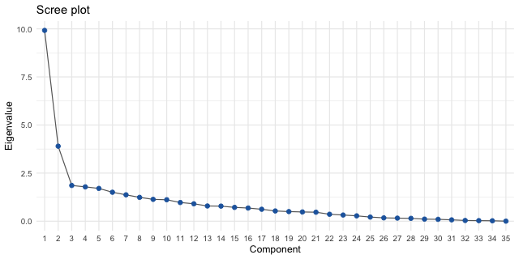

# Sparse factor model for P

The 35 log-transformed mouse traits are dominated by a single size
gradient: the first principal component takes about 40% of the variance
and the eigenvalues then fall away quickly. That is the low-rank
structure a factor model describes, so
`lm_phen_cov(covariance_structure = "factor")` estimates `P` as a few
sparse factors plus trait-specific variances instead of a full 35 by 35
correlation matrix.

The factors stay on the observed log-trait scale on purpose. Rotating
the traits first (size plus shape scores, see
[`size_shape()`](https://diogro.github.io/stanimal/reference/size_shape.md))
spreads every loading over all 35 traits, which destroys the sparsity
the prior is there to find and moves the low-rank structure out of `P`
and into the rotation itself.

``` r

library(stanimal)
```

``` r

traits <- names(ratones_morpho)[12:46]
Y <- log(as.matrix(ratones_morpho[, traits]))
X <- stats::model.matrix(~ SEX + AGE + LIN, data = ratones_morpho)
dim(Y)
#> [1] 329  35
round(pc1_variance_share(Y), 3)
#> [1] 0.406
```

## How many factors?

The scree says where the low-rank structure is, and parallel analysis
says how many dimensions clear the noise floor. That count is an upper
bound, not a target.

``` r

set.seed(1)
suggested <- suggest_n_factors(Y, X)
c(dimensions = as.integer(suggested), variance_share = round(attr(suggested, "share"), 2))
#>     dimensions variance_share 
#>           7.00           0.63
round(scree_eigenvalues(Y, X)[1:8, ], 3)
#>   component eigenvalue share cumulative
#> 1         1      9.919 0.283      0.283
#> 2         2      3.899 0.111      0.395
#> 3         3      1.858 0.053      0.448
#> 4         4      1.784 0.051      0.499
#> 5         5      1.704 0.049      0.548
#> 6         6      1.505 0.043      0.591
#> 7         7      1.370 0.039      0.630
#> 8         8      1.239 0.035      0.665
```

``` r

plot(scree_eigenvalues(Y, X))
```



plot of chunk scree

Parallel analysis keeps 7 dimensions, but the first two stand clear of a
flat tail and the last ones only just clear their cutoffs. A
three-factor fit gives bimodal communalities (`Rhat` 1.5 across four
chains), which is the model saying that direction is not in the data, so
two factors it is. The column decay is stronger than the 0.8 default
because the two columns come out at similar sizes: at 0.8 their labels
swap between chains, and at 0.5 they are ordered and converge.

## Fit

``` r

fit <- lm_phen_cov(
  Y, X,
  covariance_structure = "factor", n_factors = 2,
  hs_global_scale = 2, hs_slab_scale = 2,
  column_decay = 0.5,
  iter = 2000, warmup = 1000, chains = 4, cores = 4,
  refresh = 0, show_messages = FALSE, seed = 1
)
fit$diagnostic_summary()
#> $num_divergent
#> [1] 0 0 0 0
#> 
#> $num_max_treedepth
#> [1] 0 0 0 0
#> 
#> $ebfmi
#> [1] 0.8985592 0.9778778 0.9336933 0.8926281
```

## Against the least-squares residual covariance

`P` is on the log-trait scale, so it is directly comparable with the
covariance of the least-squares residuals. A factor model is a rank-`k`
approximation, so its error has to be read against the best a rank-`k`
structure can do, not against zero. The errors are on the correlation
scale, because an absolute error on variances of about 0.001 says
nothing.

``` r

P_hat <- draws_mean(fit, "P")
P_ols <- stats::cov(stats::lm.fit(X, Y)$residuals)
corr_hat <- stats::cov2cor(P_hat)
corr_ols <- stats::cov2cor(P_ols)
relative_error <- function(estimate, target)
  sqrt(mean((estimate - target)^2) / mean(target^2))

eigen_ols <- eigen(corr_ols, symmetric = TRUE)
best_rank <- eigen_ols$vectors[, 1:2] %*% diag(eigen_ols$values[1:2]) %*%
  t(eigen_ols$vectors[, 1:2])
diag(best_rank) <- 1
c(factor_model = relative_error(corr_hat, corr_ols),
  best_rank_2 = relative_error(best_rank, corr_ols))
#> factor_model  best_rank_2 
#>    0.2528030    0.2522873
round(rbind(factor = diag(P_hat)[1:5], ols = diag(P_ols)[1:5]), 4)
#>         IS_PM IS_NSL IS_PNS PM_ZS PM_ZI
#> factor 0.0018 0.0017  7e-04 9e-04 1e-03
#> ols    0.0017 0.0016  7e-04 9e-04 9e-04
```

The horseshoe shrinks, so the fitted correlations should sit slightly
closer to zero than the least-squares ones. A large gap the other way
would mean the prior is inflating the common structure instead of
smoothing it.

``` r

c(factor_model = mean(abs(corr_hat[upper.tri(corr_hat)])),
  ols = mean(abs(corr_ols[upper.tri(corr_ols)])))
#> factor_model          ols 
#>     0.216018     0.237982
```

## Loadings, communality and uniqueness

A factor’s sign is unidentified: flipping one loading column leaves `P`
unchanged, so a chain can visit both orientations, and averaging them
would cancel the factor out of the posterior mean.
[`draws_mean()`](https://diogro.github.io/stanimal/reference/draws_mean.md)
aligns every draw to the trait with the largest mean absolute loading
first, so nothing needs to be done here.

Communality is the share of a trait’s variance taken by the common
factors, and uniqueness is its complement. Both are invariant to
rotation; loadings and factor magnitudes are not, so read those only
after `P` and communality have converged.

``` r

lambda <- draws_mean(fit, "loadings")
round(lambda[1:5, ], 3)
#>        factor1 factor2
#> IS_PM    0.572   0.184
#> IS_NSL   0.269  -0.016
#> IS_PNS   0.846   0.167
#> PM_ZS    0.646   0.058
#> PM_ZI    0.766  -0.082
fit$summary("factor_magnitude")[, c("variable", "mean", "sd", "rhat", "ess_bulk")]
#> # A tibble: 2 × 5
#>   variable             mean    sd  rhat ess_bulk
#>   <chr>               <dbl> <dbl> <dbl>    <dbl>
#> 1 factor_magnitude[1]  7.80 0.684  1.00     422.
#> 2 factor_magnitude[2]  4.99 0.566  1.00     359.
fit$summary("communality")[1:5, c("variable", "mean", "sd", "rhat", "ess_bulk")]
#> # A tibble: 5 × 5
#>   variable         mean     sd  rhat ess_bulk
#>   <chr>           <dbl>  <dbl> <dbl>    <dbl>
#> 1 communality[1] 0.369  0.0443 1.000    2774.
#> 2 communality[2] 0.0780 0.0303 1.00     3506.
#> 3 communality[3] 0.753  0.0270 1.00     2445.
#> 4 communality[4] 0.427  0.0460 1.000    2973.
#> 5 communality[5] 0.600  0.0409 1.00     2786.
sum(draws_mean(fit, "communality"))   # total common variance
#> [1] 12.79445
```

``` r

plot_corr(corr_hat, "Factor P: posterior mean correlations")
```


plot of chunk heatmaps

``` r

plot_corr(corr_ols, "Least-squares residual correlations")
```


plot of chunk heatmaps

``` r

plot_corr(lambda, "Posterior mean loadings")
```


plot of chunk loading-heatmap
