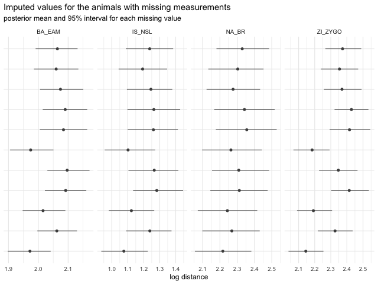

# Incomplete trait records

Traits are rarely measured on everyone. Dropping the individuals with a
gap throws away the traits that *were* measured on them, and with
relatedness it is unnecessary: a missing value is informed by every
relative’s observed traits. The opossum data ship that way (11 of the
animals with a recorded sex and age have none of these four traits
measured), so the model is fitted with the gaps in place and
[`imputed_data()`](https://diogro.github.io/stanimal/reference/imputed_data.md)
fills them from the relatives’ records.

``` r

library(stanimal)
library(ggplot2)
```

## Data, with the gaps already in it

Four distances spanning the skull from the nasal suture to the
basicranium, positively correlated with each other (0.39 to 0.78). That
correlation is what lets a gap borrow from the other traits of the same
animal, on top of what its relatives say.

``` r

traits <- c("IS_NSL", "NA_BR", "ZI_ZYGO", "BA_EAM")
dat <- opossum
dat[traits] <- log(dat[traits])   # morphometrics are fitted on the log scale
```

[`animal_design()`](https://diogro.github.io/stanimal/reference/animal_design.md)
drops the rows with a missing predictor (age), but keeps the rows whose
response has gaps.

``` r

design <- suppressWarnings(
  animal_design(cbind(IS_NSL, NA_BR, ZI_ZYGO, BA_EAM) ~ sex + age, data = dat))
Y <- design$Y
A <- opossum_grm[rownames(Y), rownames(Y)]
c(missing_entries = sum(is.na(Y)), entries = length(Y),
  incomplete_animals = sum(!complete.cases(Y)),
  complete_animals = sum(complete.cases(Y)))
#>    missing_entries            entries incomplete_animals   complete_animals 
#>                 44               2064                 11                505
```

## Fit with the gaps in place

Nothing is dropped: the gaps become parameters of the model, with a flat
prior, so the posterior over `G`, `E` and `beta` is the exact marginal
over the observed data.

``` r

fit <- lmm_animal(Y, design$X, A, lkj_prior = 2,
                  iter = 800, warmup = 400, chains = 2,
                  refresh = 0, seed = 1)
#> Running MCMC with 2 parallel chains...
#> Chain 2 finished in 24.4 seconds.
#> Chain 1 finished in 28.8 seconds.
#> 
#> Both chains finished successfully.
#> Mean chain execution time: 26.6 seconds.
#> Total execution time: 29.0 seconds.
fit$summary(c("h2", "corrG"))
#> # A tibble: 20 × 10
#>    variable    mean  median     sd    mad      q5   q95   rhat ess_bulk ess_tail
#>    <chr>      <dbl>   <dbl>  <dbl>  <dbl>   <dbl> <dbl>  <dbl>    <dbl>    <dbl>
#>  1 h2[1]     0.0970  0.0914 0.0402 0.0374  0.0436 0.171  1.01      681.     408.
#>  2 h2[2]     0.173   0.169  0.0492 0.0479  0.101  0.258  1.00      580.     330.
#>  3 h2[3]     0.194   0.188  0.0527 0.0543  0.115  0.287  1.01      580.     458.
#>  4 h2[4]     0.217   0.215  0.0509 0.0493  0.139  0.307  1.01      725.     664.
#>  5 corrG[1…  1       1      0      0       1      1     NA          NA       NA 
#>  6 corrG[2… -0.161  -0.172  0.219  0.233  -0.503  0.201  0.999    1254.     766.
#>  7 corrG[3…  0.309   0.324  0.199  0.204  -0.0304 0.617  1.00      594.     514.
#>  8 corrG[4…  0.496   0.507  0.182  0.181   0.164  0.774  1.00      737.     515.
#>  9 corrG[1… -0.161  -0.172  0.219  0.233  -0.503  0.201  0.999    1254.     766.
#> 10 corrG[2…  1       1      0      0       1      1     NA          NA       NA 
#> 11 corrG[3…  0.0732  0.0708 0.194  0.195  -0.233  0.403  1.00     1156.     673.
#> 12 corrG[4…  0.0912  0.0909 0.180  0.185  -0.215  0.393  1.00     1148.     818.
#> 13 corrG[1…  0.309   0.324  0.199  0.204  -0.0304 0.617  1.00      594.     514.
#> 14 corrG[2…  0.0732  0.0708 0.194  0.195  -0.233  0.403  1.00     1156.     673.
#> 15 corrG[3…  1       1      0      0       1      1     NA          NA       NA 
#> 16 corrG[4…  0.435   0.450  0.159  0.163   0.163  0.685  1.00      829.     569.
#> 17 corrG[1…  0.496   0.507  0.182  0.181   0.164  0.774  1.00      737.     515.
#> 18 corrG[2…  0.0912  0.0909 0.180  0.185  -0.215  0.393  1.00     1148.     818.
#> 19 corrG[3…  0.435   0.450  0.159  0.163   0.163  0.685  1.00      829.     569.
#> 20 corrG[4…  1       1      0      0       1      1     NA          NA       NA
```

## The completed data

[`imputed_data()`](https://diogro.github.io/stanimal/reference/imputed_data.md)
returns individuals by traits by draws, with the gaps filled on the
response scale. These are multiple imputations: do not collapse them to
one filled-in matrix and treat it as data.

``` r

imp <- imputed_data(fit, ndraws = 500, seed = 2)
imp
#> <stanimal_imputation> 500 completed datasets of 516 individuals and 4 trait(s), 44 imputed value(s)
#>  individual   trait  mean  q2.5 q97.5
#>       K1813  IS_NSL 1.237 1.088 1.384
#>       K1813   NA_BR 2.329 2.180 2.485
#>       K1813 ZI_ZYGO 2.373 2.266 2.489
#>       K1813  BA_EAM 2.064 1.991 2.132
#>       K2355  IS_NSL 1.193 1.043 1.347
#>       K2355   NA_BR 2.303 2.133 2.452
#>       K2355 ZI_ZYGO 2.354 2.239 2.470
#>       K2355  BA_EAM 2.060 1.985 2.134
#>       K7802  IS_NSL 1.245 1.095 1.379
#>       K7802   NA_BR 2.276 2.123 2.432
#>       K7802 ZI_ZYGO 2.369 2.258 2.491
#>       K7802  BA_EAM 2.074 2.006 2.151
#>       L1497  IS_NSL 1.263 1.098 1.428
#>       L1497   NA_BR 2.342 2.167 2.517
#>       L1497 ZI_ZYGO 2.428 2.323 2.534
#>       L1497  BA_EAM 2.090 2.015 2.164
#>       L2196  IS_NSL 1.260 1.099 1.414
#>       L2196   NA_BR 2.355 2.176 2.528
#>       L2196 ZI_ZYGO 2.416 2.293 2.546
#>       L2196  BA_EAM 2.084 2.005 2.164
#>       L2820  IS_NSL 1.102 0.955 1.272
#>       L2820   NA_BR 2.264 2.097 2.443
#>       L2820 ZI_ZYGO 2.184 2.068 2.293
#>       L2820  BA_EAM 1.974 1.905 2.051
#>       L4268  IS_NSL 1.266 1.104 1.417
#>       L4268   NA_BR 2.309 2.154 2.485
#>       L4268 ZI_ZYGO 2.347 2.227 2.466
#>       L4268  BA_EAM 2.097 2.030 2.172
#>       L6009  IS_NSL 1.281 1.133 1.447
#>       L6009   NA_BR 2.312 2.144 2.476
#>       L6009 ZI_ZYGO 2.415 2.303 2.537
#>       L6009  BA_EAM 2.092 2.022 2.161
#>       L7483  IS_NSL 1.123 0.981 1.266
#>       L7483   NA_BR 2.243 2.072 2.416
#>       L7483 ZI_ZYGO 2.192 2.090 2.308
#>       L7483  BA_EAM 2.016 1.947 2.091
#>       L7492  IS_NSL 1.238 1.089 1.374
#>       L7492   NA_BR 2.269 2.098 2.430
#>       L7492 ZI_ZYGO 2.326 2.219 2.436
#>       L7492  BA_EAM 2.062 1.997 2.130
#>       L7600  IS_NSL 1.075 0.934 1.225
#>       L7600   NA_BR 2.217 2.055 2.382
#>       L7600 ZI_ZYGO 2.144 2.037 2.254
#>       L7600  BA_EAM 1.972 1.897 2.041
dim(imp$Y)
#> [1] 516   4 500
```

What the model believes about each gap:

``` r

gaps <- imp$gaps
intervals <- t(vapply(seq_len(nrow(gaps)), function(i) {
  v <- imp$Y[gaps$individual[i], gaps$trait[i], ]
  c(mean = mean(v), lo = unname(quantile(v, 0.025)),
    hi = unname(quantile(v, 0.975)))
}, c(mean = 0, lo = 0, hi = 0)))
plot_dat <- data.frame(
  gap = sprintf("%s / %s", gaps$individual_label, gaps$trait_label),
  trait = gaps$trait_label,
  mean = intervals[, "mean"], lo = intervals[, "lo"], hi = intervals[, "hi"])
plot_dat$gap <- factor(plot_dat$gap,
                       levels = rev(plot_dat$gap[order(plot_dat$trait)]))

ggplot(plot_dat, aes(x = mean, y = gap)) +
  geom_pointrange(aes(xmin = lo, xmax = hi), colour = "grey30", size = 0.2) +
  facet_wrap(~trait, scales = "free", nrow = 1) +
  labs(x = "log distance", y = NULL,
       title = "Imputed values for the animals with missing measurements",
       subtitle = "posterior mean and 95% interval for each missing value") +
  theme_minimal() +
  theme(axis.text.y = element_blank())
```



plot of chunk plot
