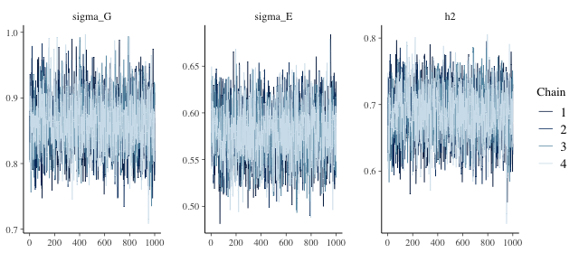
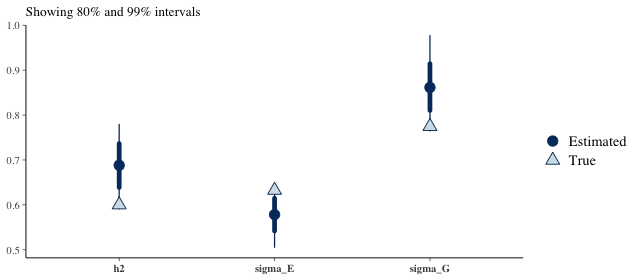
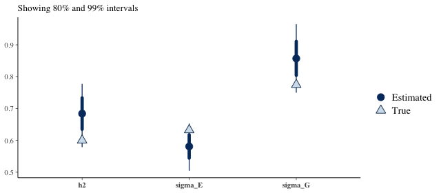
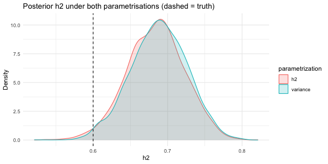

# Univariate animal model

[`lmm_animal()`](https://diogro.github.io/stanimal/reference/lmm_animal.md)
fits a single trait under two parametrisations:

- `"variance"` (the default) puts half-normal priors on the genetic and
  residual standard deviations, and derives h2 = s_G^2 / (s_G^2 +
  s_E^2);
- `"h2"` puts a half-normal prior on the total standard deviation and a
  beta prior on h2 itself (`beta_prior`; `c(1, 1)` is flat).

This vignette simulates one trait on a random pedigree, fits it both
ways and compares the two posteriors with the simulated truth.

``` r

library(stanimal)
library(pedtools)   # randomPed(); install with pak::pkg_install("cran/pedtools")
library(ggplot2)
```

## Simulation

A random pedigree of 1,500 individuals, a heritability of 0.6 and a sex
effect.

``` r

ped <- randomPed(1500, 50, seed = 2)
ped <- data.frame(id = ped$ID, sire = ped$FIDX, dam = ped$MIDX)
A <- makeA(ped)
L_A <- chol(A)
n <- nrow(A)

set.seed(41)
h2_true <- 0.6
G <- h2_true          # additive genetic variance (P = 1)
E <- 1 - h2_true      # residual variance

a <- sqrt(G) * (t(L_A) %*% rnorm(n))   # Var(a) = G A

beta <- matrix(c(1, 0.3), 2, 1,
               dimnames = list(c("Intercept", "sex"), "trait"))
X <- cbind(Intercept = 1, sex = sample(c(0, 1), n, replace = TRUE))
e <- rnorm(n, sd = sqrt(E))

Y <- X %*% beta + a + e
colnames(Y) <- "trait"

truth <- c(h2 = h2_true, sigma_G = sqrt(G), sigma_E = sqrt(E))
round(truth, 3)
#>      h2 sigma_G sigma_E 
#>   0.600   0.775   0.632
```

## Fitting both parametrisations

``` r

fit_var <- lmm_animal(Y, X, A, parametrization = "variance",
                      iter = 3000, warmup = 2000, chains = 4, cores = 4,
                      refresh = 0, seed = 1)
#> Running MCMC with 4 parallel chains...
#> Chain 1 finished in 3.0 seconds.
#> Chain 4 finished in 2.9 seconds.
#> Chain 2 finished in 3.1 seconds.
#> Chain 3 finished in 3.4 seconds.
#> 
#> All 4 chains finished successfully.
#> Mean chain execution time: 3.1 seconds.
#> Total execution time: 3.9 seconds.
fit_h2 <- lmm_animal(Y, X, A, parametrization = "h2", beta_prior = c(1, 1),
                     iter = 3000, warmup = 2000, chains = 4, cores = 4,
                     refresh = 0, seed = 1)
#> Running MCMC with 4 parallel chains...
#> Chain 1 finished in 3.9 seconds.
#> Chain 2 finished in 4.2 seconds.
#> Chain 4 finished in 4.1 seconds.
#> Chain 3 finished in 4.2 seconds.
#> 
#> All 4 chains finished successfully.
#> Mean chain execution time: 4.1 seconds.
#> Total execution time: 4.8 seconds.
```

Both report the same quantities on the original scale: `h2`, `sigma_G`
and `sigma_E`, plus the fixed effects.

``` r

fit_var$summary(c("h2", "sigma_G", "sigma_E", "beta"))
#> # A tibble: 5 × 10
#>   variable  mean median     sd    mad    q5   q95  rhat ess_bulk ess_tail
#>   <chr>    <dbl>  <dbl>  <dbl>  <dbl> <dbl> <dbl> <dbl>    <dbl>    <dbl>
#> 1 h2       0.688  0.689 0.0380 0.0385 0.624 0.749  1.00    1851.    1780.
#> 2 sigma_G  0.862  0.861 0.0407 0.0405 0.796 0.930  1.00    2013.    1917.
#> 3 sigma_E  0.578  0.579 0.0283 0.0281 0.531 0.625  1.00    2108.    2057.
#> 4 beta[1]  1.09   1.09  0.136  0.136  0.867 1.31   1.00    3014.    2447.
#> 5 beta[2]  0.343  0.342 0.0424 0.0428 0.274 0.411  1.00    2822.    2297.
fit_h2$summary(c("h2", "sigma_G", "sigma_E", "beta"))
#> # A tibble: 5 × 10
#>   variable  mean median     sd    mad    q5   q95  rhat ess_bulk ess_tail
#>   <chr>    <dbl>  <dbl>  <dbl>  <dbl> <dbl> <dbl> <dbl>    <dbl>    <dbl>
#> 1 h2       0.684  0.685 0.0386 0.0384 0.620 0.747  1.00    1885.    2254.
#> 2 sigma_G  0.857  0.857 0.0412 0.0410 0.790 0.926  1.00    1759.    1847.
#> 3 sigma_E  0.581  0.581 0.0285 0.0280 0.534 0.627  1.00    2404.    2901.
#> 4 beta[1]  1.09   1.09  0.133  0.132  0.873 1.32   1.00    2740.    2492.
#> 5 beta[2]  0.342  0.342 0.0428 0.0430 0.272 0.412  1.00    3121.    2615.
```

The fixed effects are named after the columns of `X`:

``` r

beta_draws_var <- rename_beta(fit_var, "beta")
posterior::summarise_draws(beta_draws_var)
#> # A tibble: 2 × 10
#>   variable         mean median     sd    mad    q5   q95  rhat ess_bulk ess_tail
#>   <chr>           <dbl>  <dbl>  <dbl>  <dbl> <dbl> <dbl> <dbl>    <dbl>    <dbl>
#> 1 beta[Intercept] 1.09   1.09  0.136  0.136  0.867 1.31   1.00    3014.    2447.
#> 2 beta[sex]       0.343  0.342 0.0424 0.0428 0.274 0.411  1.00    2822.    2297.
```

Posterior means against the simulated truth:

``` r

rbind(variance = c(h2 = unname(draws_mean(fit_var, "h2")),
                   sigma_G = unname(draws_mean(fit_var, "sigma_G")),
                   sigma_E = unname(draws_mean(fit_var, "sigma_E"))),
      h2 = c(h2 = unname(draws_mean(fit_h2, "h2")),
             sigma_G = unname(draws_mean(fit_h2, "sigma_G")),
             sigma_E = unname(draws_mean(fit_h2, "sigma_E"))),
      truth = truth)
#>                 h2   sigma_G   sigma_E
#> variance 0.6881548 0.8615085 0.5782723
#> h2       0.6840105 0.8571225 0.5808681
#> truth    0.6000000 0.7745967 0.6324555
round(drop(draws_mean(fit_var, "beta")), 3)
#> Intercept       sex 
#>     1.088     0.343
t(beta)
#>       Intercept sex
#> trait         1 0.3
```

## Diagnostics

E-BFMI is where the two parametrisations can differ. When the genetic
variance is weakly identified, the variance version mixes poorly in the
neck between the two variance components;
[`lmm_animal()`](https://diogro.github.io/stanimal/reference/lmm_animal.md)
then warns and suggests `parametrization = "h2"`. Here the pedigree is
large and both are fine.

``` r

rbind(variance = fit_var$diagnostic_summary(quiet = TRUE)$ebfmi,
      h2 = fit_h2$diagnostic_summary(quiet = TRUE)$ebfmi)
#>               [,1]      [,2]     [,3]      [,4]
#> variance 1.1065688 0.9442534 1.027216 0.9358094
#> h2       0.9769259 0.9893814 1.094556 0.9586090
fit_var$summary(c("h2", "sigma_G", "sigma_E"),
                posterior::default_convergence_measures())
#> # A tibble: 3 × 4
#>   variable  rhat ess_bulk ess_tail
#>   <chr>    <dbl>    <dbl>    <dbl>
#> 1 h2        1.00    1851.    1780.
#> 2 sigma_G   1.00    2013.    1917.
#> 3 sigma_E   1.00    2108.    2057.
fit_h2$summary(c("h2", "sigma_G", "sigma_E"),
               posterior::default_convergence_measures())
#> # A tibble: 3 × 4
#>   variable  rhat ess_bulk ess_tail
#>   <chr>    <dbl>    <dbl>    <dbl>
#> 1 h2        1.00    1885.    2254.
#> 2 sigma_G   1.00    1759.    1847.
#> 3 sigma_E   1.00    2404.    2901.
```

``` r

bayesplot::color_scheme_set("blue")
bayesplot::mcmc_trace(fit_var$draws(c("sigma_G", "sigma_E", "h2")))
```



plot of chunk trace

## Intervals against the truth

In
[`bayesplot::mcmc_recover_intervals()`](https://mc-stan.org/bayesplot/reference/MCMC-recover.html)
the filled circle is the posterior mean, the thick and thin segments are
the 80% and 99% intervals, and the simulated value is the hollow
triangle.

``` r

interval_plot <- function(fit, pars, truth) {
  bayesplot::mcmc_recover_intervals(
    fit$draws(pars), true = stats::setNames(truth, pars),
    prob = 0.8, prob_outer = 0.99, point_est = "mean")
}
interval_plot(fit_var, c("h2", "sigma_G", "sigma_E"), truth)
```



plot of chunk intervals

``` r

interval_plot(fit_h2, c("h2", "sigma_G", "sigma_E"), truth)
```



plot of chunk intervals

## Prior against posterior

[`plot_prior_posterior()`](https://diogro.github.io/stanimal/reference/plot_prior_posterior.md)
and
[`plot_forest()`](https://diogro.github.io/stanimal/reference/plot_prior_posterior.md)
rebuild the prior the fit recorded, so the comparison is always against
the prior that was actually used.

``` r

plot_prior_posterior(fit_var, trait_names = "trait", ncol = 3)
```


plot of chunk prior-posterior

``` r

plot_forest(fit_var, trait_names = "trait")
```


plot of chunk prior-posterior

Under `"variance"`, h2 is derived from two half-normal standard
deviations, so its prior is not flat; under `"h2"` it is Beta(1, 1).
With 1,500 individuals the data dominate and the two posteriors agree:

``` r

draws_of <- function(fit, label)
  data.frame(h2 = as.vector(posterior::as_draws_matrix(fit$draws("h2"))),
             parametrization = label)
h2_draws <- rbind(draws_of(fit_var, "variance"), draws_of(fit_h2, "h2"))
ggplot(h2_draws, aes(h2, colour = parametrization, fill = parametrization)) +
  geom_density(alpha = 0.2) +
  geom_vline(xintercept = h2_true, linetype = "dashed") +
  labs(x = "h2", y = "Density",
       title = "Posterior h2 under both parametrisations (dashed = truth)") +
  theme_minimal()
```



plot of chunk h2-densities
