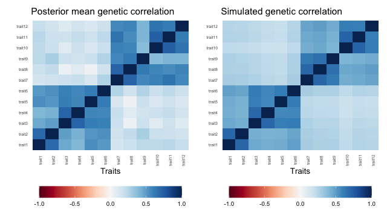

With many traits an unstructured `G` has many parameters, and most of them are
weakly identified. `genetic_structure = "factor"` writes `G` as a few sparse
latent factors plus trait-specific variances, with regularized-horseshoe
loadings. This vignette simulates twelve traits from a nine-factor hierarchy (a
general size factor, two broad blocks, four unequal sub-blocks and two nested
sub-sub-blocks), fits the factor model, and compares the posterior `G`, genetic
correlations, heritabilities, uniqueness and factor magnitudes with the
simulation.


``` r
library(stanimal)
library(patchwork)   # to place plots side by side
```

## Simulation


``` r
set.seed(1)
n_traits <- 12L
n_factors <- 9L
traits <- sprintf("trait%d", seq_len(n_traits))

Lambda <- matrix(0, n_traits, n_factors)
colnames(Lambda) <- c("size", "block1", "block2",
                      "sub1a", "sub1b", "sub2a", "sub2b",
                      "subsub1", "subsub2")
Lambda[, 1] <- c(0.62, 0.58, 0.55, 0.50, 0.48, 0.52,
                 0.60, 0.56, 0.53, 0.49, 0.57, 0.51)
Lambda[1:6, 2] <- c(0.55, 0.50, 0.45, 0.48, 0.52, 0.40)
Lambda[7:12, 3] <- c(0.50, 0.58, 0.45, 0.55, 0.48, 0.52)
Lambda[1:2, 4] <- c(0.55, 0.50)               # sub-block 1a: traits 1-2
Lambda[3:6, 5] <- c(0.50, 0.45, 0.55, 0.40)   # sub-block 1b: traits 3-6
Lambda[7:9, 6] <- c(0.45, 0.50, 0.40)         # sub-block 2a: traits 7-9
Lambda[10:12, 7] <- c(0.55, 0.50, 0.45)       # sub-block 2b: traits 10-12
Lambda[3:4, 8] <- c(0.45, 0.40)               # nested in sub-block 1b
Lambda[10:11, 9] <- c(0.45, 0.40)             # nested in sub-block 2b

Psi <- c(0.35, 0.40, 0.30, 0.45, 0.50, 0.35,
         0.40, 0.30, 0.45, 0.35, 0.40, 0.45)
G <- Lambda %*% t(Lambda) + diag(Psi)
E <- diag(c(0.80, 0.90, 0.75, 0.85, 0.95, 0.80,
            0.90, 0.75, 0.85, 0.80, 0.90, 0.75))
dimnames(G) <- dimnames(E) <- list(traits, traits)
```

Five generations of 120 individuals, with sex-consistent parents:


``` r
n_gen <- 5L; n_breed <- 120L
ped <- data.frame(id = seq_len(n_gen * n_breed),
                  sire = NA_integer_, dam = NA_integer_,
                  sex = NA_character_)
ped$sex[seq_len(n_breed)] <- sample(rep(c("M", "F"), each = n_breed / 2))
for (g in 2:n_gen) {
  kids <- ((g - 1) * n_breed + 1):(g * n_breed)
  pool <- ped[ped$id < min(kids), ]
  ped$sire[kids] <- sample(pool$id[pool$sex == "M"], n_breed, TRUE)
  ped$dam[kids]  <- sample(pool$id[pool$sex == "F"], n_breed, TRUE)
  ped$sex[kids]  <- sample(c("M", "F"), n_breed, TRUE)
}
A <- makeA(ped)

n <- nrow(A)
X <- cbind(Intercept = 1, sex = rbinom(n, 1, 0.5),
           age = round(rnorm(n, 3, 0.5), 2))
B <- rbind(rep(10, n_traits),
           seq(-1, 1.5, length.out = n_traits),
           seq(-0.4, 0.7, length.out = n_traits))
u <- t(chol(A)) %*% matrix(rnorm(n * n_traits), n) %*% chol(G)
e <- matrix(rnorm(n * n_traits), n) %*% chol(E)
Y <- X %*% B + u + e
colnames(Y) <- traits
```

## Fit

The hierarchy is ordered from broad to narrow, so a mild `column_decay` favours
that order without forcing it. See the prior section of `AGENTS.md` (or
`?lmm_animal`) for how `n_factors`, `column_decay` and the horseshoe scales
interact.


``` r
fit <- lmm_animal(
  Y, X, A,
  genetic_structure = "factor", n_factors = n_factors,
  hs_global_scale = 2, hs_slab_scale = 2,
  column_decay = 0.9,
  iter = 2500, warmup = 1250, chains = 4, cores = 4,
  refresh = 0, show_messages = FALSE, seed = 1
)
fit$diagnostic_summary()
#> $num_divergent
#> [1] 0 0 0 0
#> 
#> $num_max_treedepth
#> [1] 0 0 0 0
#> 
#> $ebfmi
#> [1] 0.8174431 0.8700632 0.8577596 0.8604595
```

## Recovery of G

The error is reported relative to the size of `G`, so it reads as a share of
the target whatever scale the simulation uses. An absolute error on a covariance
matrix means nothing without the variances it should be compared with.


``` r
relative_mse <- function(estimate, truth)
  mean((estimate - truth)^2) / mean(truth^2)
G_hat <- draws_mean(fit, "G")
round(sqrt(relative_mse(G_hat, G)), 3)
#> [1] 0.239
round(G_hat[1:6, 1:6], 2)
#>        trait1 trait2 trait3 trait4 trait5 trait6
#> trait1   1.55   0.95   0.70   0.60   0.91   0.66
#> trait2   0.95   1.20   0.68   0.55   0.77   0.61
#> trait3   0.70   0.68   1.57   1.08   1.02   0.77
#> trait4   0.60   0.55   1.08   1.44   0.92   0.71
#> trait5   0.91   0.77   1.02   0.92   1.80   0.85
#> trait6   0.66   0.61   0.77   0.71   0.85   1.08
round(G[1:6, 1:6], 2)
#>        trait1 trait2 trait3 trait4 trait5 trait6
#> trait1   1.34   0.91   0.59   0.57   0.58   0.54
#> trait2   0.91   1.24   0.54   0.53   0.54   0.50
#> trait3   0.59   0.54   1.26   0.90   0.77   0.67
#> trait4   0.57   0.53   0.90   1.29   0.74   0.63
#> trait5   0.58   0.54   0.77   0.74   1.30   0.68
#> trait6   0.54   0.50   0.67   0.63   0.68   0.94
```

The genetic correlations recover the overlapping module structure:


``` r
plot_corr(draws_mean(fit, "corrG"), "Posterior mean genetic correlation") +
  plot_corr(cov2cor(G), "Simulated genetic correlation")
```

<div class="figure">

<p class="caption">plot of chunk corr</p>
</div>

## Heritability, communality and uniqueness

These are the easiest summaries to compare with the simulation, because they do
not depend on the orientation of the factors. Loadings are only identified up
to rotation and sign, so their posterior means can be near zero even when `G`
is recovered.


``` r
h2_hat <- draws_mean(fit, "h2")
h2_true <- diag(G) / diag(G + E)
round(rbind(estimate = h2_hat, truth = h2_true), 2)
#>          trait1 trait2 trait3 trait4 trait5 trait6 trait7 trait8 trait9 trait10
#> estimate   0.63   0.58   0.68   0.59   0.67   0.61   0.56   0.70   0.61    0.69
#> truth      0.63   0.58   0.63   0.60   0.58   0.54   0.57   0.62   0.56    0.64
#>          trait11 trait12
#> estimate    0.66    0.56
#> truth       0.60    0.61

round(rbind(estimate = draws_mean(fit, "communality"),
            truth = rowSums(Lambda^2) / diag(G)), 2)
#>          trait1 trait2 trait3 trait4 trait5 trait6 trait7 trait8 trait9 trait10
#> estimate   0.81   0.81   0.83   0.81   0.76   0.74   0.85   0.87   0.71    0.84
#> truth      0.74   0.68   0.76   0.65   0.62   0.63   0.67   0.75   0.59    0.75
#>          trait11 trait12
#> estimate    0.83    0.72
#> truth       0.71    0.62
round(rbind(estimate = draws_mean(fit, "uniqueness"),
            truth = Psi / diag(G)), 2)
#>          trait1 trait2 trait3 trait4 trait5 trait6 trait7 trait8 trait9 trait10
#> estimate   0.19   0.19   0.17   0.19   0.24   0.26   0.15   0.13   0.29    0.16
#> truth      0.26   0.32   0.24   0.35   0.38   0.37   0.33   0.25   0.41    0.25
#>          trait11 trait12
#> estimate    0.17    0.28
#> truth       0.29    0.38
```

The fit overstates the communalities, and so understates the uniqueness, of
every trait here, and puts `h2` a little too high for several of them.
Before reading the uniqueness of real traits, check how large this bias is in a simulation like
this one.

`factor_magnitude` is the squared norm of each loading column on the correlation
scale. It depends on the orientation, which only the prior pins down, so read it
with that in mind.


``` r
fit$summary("factor_magnitude")[, c("variable", "mean", "sd", "rhat", "ess_bulk")]
#> # A tibble: 9 × 5
#>   variable             mean    sd  rhat ess_bulk
#>   <chr>               <dbl> <dbl> <dbl>    <dbl>
#> 1 factor_magnitude[1] 2.48  1.32   1.01     208.
#> 2 factor_magnitude[2] 1.67  1.36   1.04     129.
#> 3 factor_magnitude[3] 1.63  1.34   1.04     110.
#> 4 factor_magnitude[4] 1.05  1.13   1.03     151.
#> 5 factor_magnitude[5] 0.725 0.850  1.01     379.
#> 6 factor_magnitude[6] 0.672 0.807  1.01     366.
#> 7 factor_magnitude[7] 0.499 0.587  1.00     488.
#> 8 factor_magnitude[8] 0.465 0.588  1.00     597.
#> 9 factor_magnitude[9] 0.409 0.499  1.00    1095.
```
