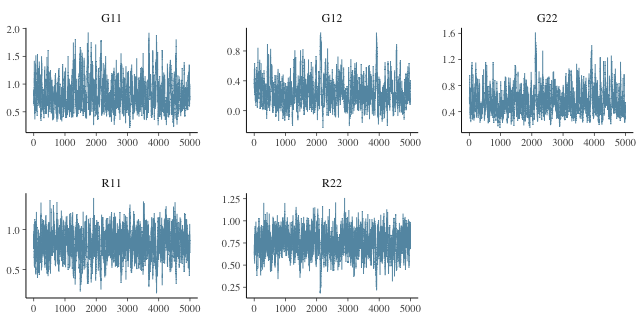
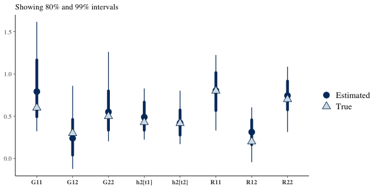

`lmm_animal_gibbs()` is a quick single-chain Gibbs sampler, meant for
simulations, teaching and sanity checks rather than for inference. Its priors
are inverse-Wishart on `G` and the residual covariance, which differ from those
of `lmm_animal()`, so the two posteriors are close but not interchangeable. It
does not need CmdStan.


``` r
library(stanimal)
```

## Simulation

Half-sib families give a block relationship matrix without any pedigree code.


``` r
set.seed(1)
n_fam <- 40; fam_size <- 8
n <- n_fam * fam_size
family <- rep(seq_len(n_fam), each = fam_size)
A <- outer(family, family, "==") * 0.5
diag(A) <- 1

G <- matrix(c(0.60, 0.30,
              0.30, 0.50), 2, byrow = TRUE)
E <- matrix(c(0.80, 0.20,
              0.20, 0.70), 2, byrow = TRUE)
X <- cbind(Intercept = 1, sex = rbinom(n, 1, 0.5))
B <- cbind(c(1.0, 0.5), c(-1.0, -0.2))
Y <- X %*% B +
  t(chol(A)) %*% matrix(rnorm(n * 2), n) %*% chol(G) +
  matrix(rnorm(n * 2), n) %*% chol(E)
colnames(Y) <- c("t1", "t2")
h2_true <- diag(G) / diag(G + E)
```

## Fit

`iter`, `warmup` and `thin` count Gibbs iterations, not Hamiltonian
trajectories. Successive draws are autocorrelated, so the effective sample size
is much smaller than the number of draws; this run keeps 5,000 of 20,000
iterations and takes a few seconds.


``` r
gibbs <- lmm_animal_gibbs(Y, X, A, iter = 20000, warmup = 5000, thin = 3)
str(gibbs, max.level = 1)
#> List of 5
#>  $ G         : num [1:2, 1:2, 1:5000] 0.652 0.299 0.299 0.583 0.666 ...
#>   ..- attr(*, "dimnames")=List of 3
#>  $ R         : num [1:2, 1:2, 1:5000] 0.927 0.268 0.268 0.731 0.763 ...
#>   ..- attr(*, "dimnames")=List of 3
#>  $ beta      : num [1:2, 1:2, 1:5000] 1.16 -1.104 0.256 -0.261 0.856 ...
#>   ..- attr(*, "dimnames")=List of 3
#>  $ h2        : num [1:2, 1:5000] 0.413 0.444 0.466 0.494 0.451 ...
#>   ..- attr(*, "dimnames")=List of 2
#>  $ iterations: num [1:5000] 5003 5006 5009 5012 5015 ...
```

The draws are plain arrays: `G` and `R` are k by k by draws, `beta` is traits by
fixed effects by draws, `h2` is traits by draws. `fit_draws()` gives the same
named arrays as for the Stan models, with the residual covariance named `E`.


``` r
gibbs_post <- fit_draws(gibbs)
round(draws_mean(gibbs_post, "G"), 2); round(G, 2)
#>      t1   t2
#> t1 0.79 0.24
#> t2 0.24 0.55
#>      [,1] [,2]
#> [1,]  0.6  0.3
#> [2,]  0.3  0.5
round(draws_mean(gibbs_post, "E"), 2); round(E, 2)
#>      t1   t2
#> t1 0.80 0.31
#> t2 0.31 0.74
#>      [,1] [,2]
#> [1,]  0.8  0.2
#> [2,]  0.2  0.7
round(draws_mean(gibbs_post, "beta"), 2); t(B)
#>    Intercept   sex
#> t1      1.09  0.50
#> t2     -0.95 -0.38
#>      [,1] [,2]
#> [1,]    1  0.5
#> [2,]   -1 -0.2
round(rbind(estimate = draws_mean(gibbs_post, "h2"), truth = h2_true), 2)
#>            t1   t2
#> estimate 0.49 0.42
#> truth    0.43 0.42
```

## Summaries as posterior draws

Flattening the arrays into a draws matrix makes `posterior` and `bayesplot`
apply.


``` r
gibbs_draws <- posterior::as_draws_matrix(cbind(
  G11 = gibbs$G[1, 1, ], G12 = gibbs$G[1, 2, ], G22 = gibbs$G[2, 2, ],
  R11 = gibbs$R[1, 1, ], R12 = gibbs$R[1, 2, ], R22 = gibbs$R[2, 2, ],
  `h2[t1]` = gibbs$h2[1, ], `h2[t2]` = gibbs$h2[2, ]))
posterior::summarise_draws(gibbs_draws)
#> # A tibble: 8 × 10
#>   variable  mean median    sd   mad       q5   q95  rhat ess_bulk ess_tail
#>   <chr>    <dbl>  <dbl> <dbl> <dbl>    <dbl> <dbl> <dbl>    <dbl>    <dbl>
#> 1 G11      0.792  0.746 0.262 0.243  0.442   1.29   1.00     309.     472.
#> 2 G12      0.240  0.220 0.174 0.155 -0.00651 0.547  1.00     267.     354.
#> 3 G22      0.551  0.523 0.192 0.172  0.295   0.901  1.00     304.     401.
#> 4 R11      0.804  0.816 0.174 0.170  0.501   1.08   1.00     354.     478.
#> 5 R12      0.313  0.318 0.119 0.117  0.120   0.502  1.00     322.     357.
#> 6 R22      0.743  0.743 0.137 0.131  0.513   0.958  1.00     380.     432.
#> 7 h2[t1]   0.489  0.478 0.126 0.127  0.300   0.717  1.00     298.     426.
#> 8 h2[t2]   0.420  0.411 0.117 0.117  0.245   0.630  1.00     298.     370.
```


``` r
bayesplot::color_scheme_set("blue")
bayesplot::mcmc_trace(gibbs_draws, pars = c("G11", "G12", "G22", "R11", "R22"))
```

<div class="figure">

<p class="caption">plot of chunk trace</p>
</div>


``` r
truth <- c(G11 = G[1, 1], G12 = G[1, 2], G22 = G[2, 2],
           R11 = E[1, 1], R12 = E[1, 2], R22 = E[2, 2],
           `h2[t1]` = h2_true[[1]], `h2[t2]` = h2_true[[2]])
bayesplot::mcmc_recover_intervals(gibbs_draws, true = truth,
                                  prob = 0.8, prob_outer = 0.99,
                                  point_est = "mean")
```

<div class="figure">

<p class="caption">plot of chunk intervals</p>
</div>
