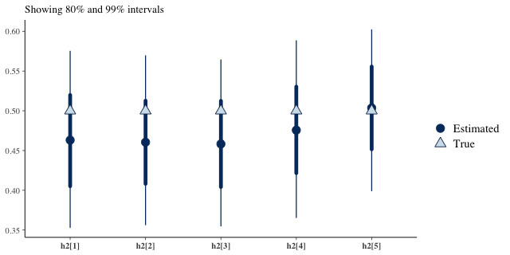
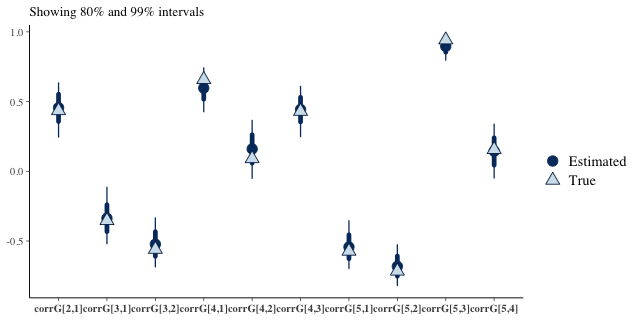
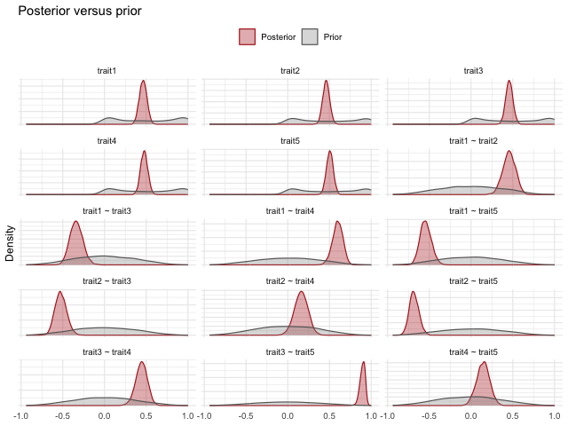
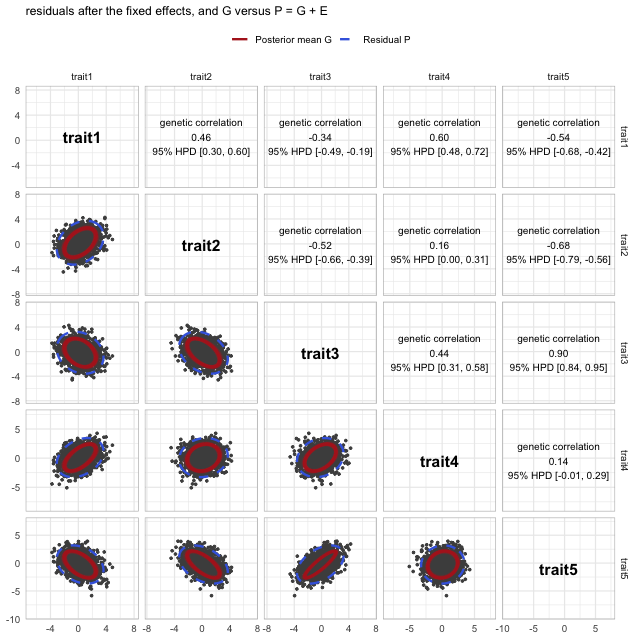
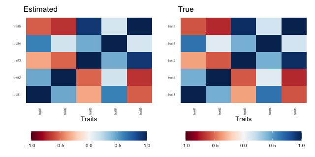
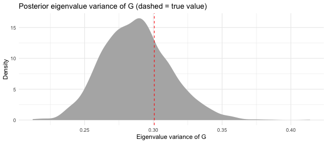

This vignette simulates five correlated traits on a random pedigree with a known
genetic covariance matrix `G`, fits the multivariate model with `lmm_animal()`,
and compares the posterior `G`, `E`, `P`, genetic correlations, heritabilities
and fixed effects with the simulated truth.


``` r
library(stanimal)
library(pedtools)   # randomPed(); install with pak::pkg_install("cran/pedtools")
library(patchwork)
library(ggplot2)
```

## Simulation

`random_covariance(method = "partial")` draws a random covariance matrix (the
package port of `evolqg::RandomMatrix(LKJ = FALSE)`). The residual covariance is
the identity.


``` r
ped <- randomPed(1500, 50, seed = 2)
ped <- data.frame(id = ped$ID, sire = ped$FIDX, dam = ped$MIDX)
A <- makeA(ped)
L_A <- chol(A)

n_traits <- 5
traits <- paste0("trait", seq_len(n_traits))

set.seed(41)
(G <- random_covariance(n_traits, method = "partial", trait_names = traits))
#>            trait1      trait2     trait3     trait4     trait5
#> trait1  1.0000000  0.43528119 -0.3527655 0.65838924 -0.5730190
#> trait2  0.4352812  1.00000000 -0.5595610 0.09106039 -0.7158400
#> trait3 -0.3527655 -0.55956098  1.0000000 0.42988339  0.9424567
#> trait4  0.6583892  0.09106039  0.4298834 1.00000000  0.1563740
#> trait5 -0.5730190 -0.71584004  0.9424567 0.15637400  1.0000000
E <- diag(n_traits)

n <- nrow(A)
a <- t(L_A) %*% matrix(rnorm(n * n_traits), n, n_traits) %*% chol(G)

beta <- matrix(c(rep(1, n_traits),
                 rnorm(n_traits, 0, 1),
                 rnorm(n_traits, 1, 1)), 3, n_traits, byrow = TRUE,
               dimnames = list(c("Intercept", "sex", "Z"), traits))
X <- cbind(Intercept = 1, sex = sample(c(0, 1), n, replace = TRUE),
           Z = rnorm(n))
e <- matrix(rnorm(n * n_traits), n, n_traits) %*% chol(E)

Y <- X %*% beta + a + e
colnames(Y) <- traits
```

## Fit


``` r
fit <- lmm_animal(Y, X, A, lkj_prior = 2,
                  iter = 3000, warmup = 2000, chains = 4, cores = 4,
                  refresh = 0, seed = 1)
#> Running MCMC with 4 parallel chains...
#> Chain 4 finished in 90.8 seconds.
#> Chain 2 finished in 96.3 seconds.
#> Chain 1 finished in 99.3 seconds.
#> Chain 3 finished in 110.1 seconds.
#> 
#> All 4 chains finished successfully.
#> Mean chain execution time: 99.1 seconds.
#> Total execution time: 110.8 seconds.
```

The fit is a `CmdStanMCMC` object: summaries and diagnostics use its methods, and
the draws work with `posterior` and `bayesplot`.


``` r
fit$summary(c("h2", "corrG"))
#> # A tibble: 30 × 10
#>    variable     mean median     sd    mad     q5    q95  rhat ess_bulk ess_tail
#>    <chr>       <dbl>  <dbl>  <dbl>  <dbl>  <dbl>  <dbl> <dbl>    <dbl>    <dbl>
#>  1 h2[1]       0.463  0.463 0.0443 0.0451  0.392  0.537  1.00    3203.    2706.
#>  2 h2[2]       0.460  0.460 0.0408 0.0402  0.394  0.529  1.00    3687.    3168.
#>  3 h2[3]       0.458  0.458 0.0421 0.0416  0.390  0.529  1.00    2415.    2477.
#>  4 h2[4]       0.476  0.476 0.0425 0.0427  0.408  0.546  1.00    2870.    2804.
#>  5 h2[5]       0.504  0.504 0.0404 0.0403  0.436  0.570  1.00    2281.    2628.
#>  6 corrG[1,1]  1      1     0      0       1      1     NA         NA       NA 
#>  7 corrG[2,1]  0.456  0.457 0.0757 0.0750  0.329  0.576  1.00    3250.    2982.
#>  8 corrG[3,1] -0.337 -0.340 0.0766 0.0776 -0.460 -0.210  1.00    2147.    2572.
#>  9 corrG[4,1]  0.597  0.598 0.0616 0.0609  0.492  0.694  1.00    2850.    3036.
#> 10 corrG[5,1] -0.543 -0.546 0.0673 0.0677 -0.648 -0.426  1.00    2349.    3212.
#> # ℹ 20 more rows
fit$diagnostic_summary()
#> $num_divergent
#> [1] 0 0 0 0
#> 
#> $num_max_treedepth
#> [1] 0 0 0 0
#> 
#> $ebfmi
#> [1] 1.030397 1.002717 1.047801 1.004827
```

`fit_draws()` returns every quantity as an array with the traits first and the
draws last, with named dimensions.


``` r
draws <- fit_draws(fit)
draws
#> <fit_draws> 4000 draws, 5 trait(s)
#> traits: trait1, trait2, trait3, trait4, trait5 
#>   G        5 x 5 x 4000
#>   E        5 x 5 x 4000
#>   P        5 x 5 x 4000
#>   corrG    5 x 5 x 4000
#>   corrE    5 x 5 x 4000
#>   corrP    5 x 5 x 4000
#>   h2       5 x 4000
#>   sigma_G  5 x 4000
#>   sigma_E  5 x 4000
#>   sigma_P  5 x 4000
#>   beta     5 x 3 x 4000
#>   s_G      5 x 4000
```

## Posterior means against the truth

`draws_mean()` and `draws_quantile()` give matrices back. Residual correlations
are not a model output; `fit_draws()` derives them from the `E` draws.


``` r
round(draws_mean(fit, "G"), 2); round(G, 2)
#>        trait1 trait2 trait3 trait4 trait5
#> trait1   0.86   0.41  -0.30   0.53  -0.50
#> trait2   0.41   0.93  -0.48   0.15  -0.65
#> trait3  -0.30  -0.48   0.91   0.40   0.84
#> trait4   0.53   0.15   0.40   0.91   0.14
#> trait5  -0.50  -0.65   0.84   0.14   0.98
#>        trait1 trait2 trait3 trait4 trait5
#> trait1   1.00   0.44  -0.35   0.66  -0.57
#> trait2   0.44   1.00  -0.56   0.09  -0.72
#> trait3  -0.35  -0.56   1.00   0.43   0.94
#> trait4   0.66   0.09   0.43   1.00   0.16
#> trait5  -0.57  -0.72   0.94   0.16   1.00
round(draws_mean(fit, "E"), 2)
#>        trait1 trait2 trait3 trait4 trait5
#> trait1   1.00   0.06  -0.06   0.04  -0.03
#> trait2   0.06   1.08  -0.07   0.02  -0.05
#> trait3  -0.06  -0.07   1.07  -0.01   0.03
#> trait4   0.04   0.02  -0.01   1.00   0.01
#> trait5  -0.03  -0.05   0.03   0.01   0.96
round(draws_mean(fit, "corrP"), 2); round(cov2cor(G + E), 2)
#>        trait1 trait2 trait3 trait4 trait5
#> trait1   1.00   0.24  -0.19   0.30  -0.28
#> trait2   0.24   1.00  -0.27   0.08  -0.35
#> trait3  -0.19  -0.27   1.00   0.20   0.44
#> trait4   0.30   0.08   0.20   1.00   0.08
#> trait5  -0.28  -0.35   0.44   0.08   1.00
#>        trait1 trait2 trait3 trait4 trait5
#> trait1   1.00   0.22  -0.18   0.33  -0.29
#> trait2   0.22   1.00  -0.28   0.05  -0.36
#> trait3  -0.18  -0.28   1.00   0.21   0.47
#> trait4   0.33   0.05   0.21   1.00   0.08
#> trait5  -0.29  -0.36   0.47   0.08   1.00
round(draws_quantile(fit, "corrE", probs = c(0.05, 0.95)), 2)
#> , , 5%
#> 
#>        trait1 trait2 trait3 trait4 trait5
#> trait1   1.00  -0.02  -0.14  -0.04  -0.10
#> trait2  -0.02   1.00  -0.14  -0.06  -0.13
#> trait3  -0.14  -0.14   1.00  -0.09  -0.06
#> trait4  -0.04  -0.06  -0.09   1.00  -0.07
#> trait5  -0.10  -0.13  -0.06  -0.07   1.00
#> 
#> , , 95%
#> 
#>        trait1 trait2 trait3 trait4 trait5
#> trait1   1.00   0.13   0.01   0.12   0.05
#> trait2   0.13   1.00   0.01   0.09   0.03
#> trait3   0.01   0.01   1.00   0.06   0.10
#> trait4   0.12   0.09   0.06   1.00   0.09
#> trait5   0.05   0.03   0.10   0.09   1.00
```

The fixed effects, with rows as traits:


``` r
round(draws_mean(fit, "beta"), 2)
#>        Intercept   sex     Z
#> trait1      0.87  0.31  2.17
#> trait2      1.03 -0.29 -0.43
#> trait3      1.05 -1.57 -0.90
#> trait4      0.96  0.74  2.31
#> trait5      1.06 -0.32 -0.22
t(beta)
#>        Intercept        sex          Z
#> trait1         1  0.3019750  2.1913930
#> trait2         1 -0.2768797 -0.4746209
#> trait3         1 -1.5898600 -0.8988280
#> trait4         1  0.7823274  2.3449193
#> trait5         1 -0.2121282 -0.1703294
```

## Intervals against the truth

In these plots the filled circle is the posterior mean, the thick and thin
segments are the 80% and 99% intervals, and the simulated value is the hollow
triangle.


``` r
bayesplot::color_scheme_set("blue")
interval_plot <- function(pars, truth) {
  bayesplot::mcmc_recover_intervals(
    fit$draws(pars), true = stats::setNames(truth, pars),
    prob = 0.8, prob_outer = 0.99, point_est = "mean")
}
pairs <- which(lower.tri(diag(n_traits)), arr.ind = TRUE)
interval_plot(sprintf("h2[%d]", seq_len(n_traits)),
              diag(G) / (diag(G) + diag(E)))
```

<div class="figure">

<p class="caption">plot of chunk intervals</p>
</div>

``` r
interval_plot(sprintf("corrG[%d,%d]", pairs[, 1], pairs[, 2]),
              cov2cor(G)[pairs])
```

<div class="figure">

<p class="caption">plot of chunk intervals</p>
</div>

## Prior against posterior

Where the prior and the posterior overlap, the data add little information.


``` r
plot_prior_posterior(fit, trait_names = traits, ncol = 3)
```

<div class="figure">

<p class="caption">plot of chunk prior-posterior</p>
</div>

## Genetic ellipses and correlations

`plot_G_ellipses()` shows the residuals after the fixed effects with posterior
draws of the `G` ellipses, and the genetic correlations.


``` r
plot_G_ellipses(fit, Y, n_show = 100, X = X)
```

<div class="figure">

<p class="caption">plot of chunk ellipses</p>
</div>


``` r
plot_corr(draws_mean(fit, "corrG"), "Estimated") +
  plot_corr(cov2cor(G), "True")
```

<div class="figure">

<p class="caption">plot of chunk corr</p>
</div>

## A derived quantity: eigenvalue variance

Any function of `G` has a posterior: apply it to every draw. Here, the relative
variance of the eigenvalues of `G`, a common measure of integration.


``` r
eig_var <- apply(draws$G, 3, evolqg::CalcEigenVar)
ggplot(data.frame(value = eig_var), aes(value)) +
  geom_density(fill = "grey70", colour = NA) +
  geom_vline(xintercept = evolqg::CalcEigenVar(G),
             colour = "red", linetype = "dashed") +
  labs(x = "Eigenvalue variance of G", y = "Density",
       title = "Posterior eigenvalue variance of G (dashed = true value)") +
  theme_minimal()
```

<div class="figure">

<p class="caption">plot of chunk eigenvar</p>
</div>
