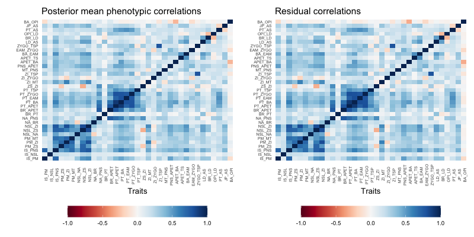

`lm_phen_cov()` estimates the phenotypic covariance matrix `P` after the fixed
effects. There is no relatedness, so no `G` and no breeding values. This
vignette fits all 35 log-transformed cranial distances of the mouse data. The
distances are strongly integrated (they share one size gradient), so the traits
are first reparametrised with `size_shape()`, and every draw is mapped back to
the log-trait scale with `back_transform()`.


``` r
library(stanimal)
library(patchwork)
```

## Size and shape scores

Keeping all `k - 1` shape axes makes the reparametrisation exact; a smaller
`n_shape` gives a lower-rank, and much cheaper, model.


``` r
ratonesdf <- ratones_morpho
traits <- names(ratonesdf)[12:46]
log_traits <- log(as.matrix(ratonesdf[, traits]))
ss <- size_shape(log_traits)
ratonesdf <- cbind(ratonesdf, ss$scores)
c(measured_traits = length(traits), model_traits = ncol(ss$scores))
#> measured_traits    model_traits 
#>              35              35
```

`animal_design()` builds `Y` and `X` from a formula. With many traits, the
`cbind()` response is assembled from the column names.


``` r
ratones_formula <- stats::reformulate(
  c("SEX", "AGE", "LIN"),
  response = sprintf("cbind(%s)", paste(ss$traits, collapse = ", ")))
ratones <- animal_design(ratones_formula, data = ratonesdf)
Y <- ratones$Y
X <- ratones$X
dim(Y)
#> [1] 329  35
```

## Fit

The LKJ prior acts on correlations between size and the shape axes, which are
principal components and so expected to be nearly uncorrelated; a firmer
`lkj_prior = 6` says so.


``` r
cov_fit <- lm_phen_cov(Y, X, lkj_prior = 6, iter = 800, warmup = 400,
                       chains = 4, cores = 4, refresh = 0, seed = 1)
#> Running MCMC with 4 parallel chains...
#> Chain 1 finished in 21.8 seconds.
#> Chain 4 finished in 22.5 seconds.
#> Chain 3 finished in 22.6 seconds.
#> Chain 2 finished in 22.9 seconds.
#> 
#> All 4 chains finished successfully.
#> Mean chain execution time: 22.4 seconds.
#> Total execution time: 23.2 seconds.
cov_fit$summary(c("sigma_P[1]", "P[1,1]", "P[2,2]", "corrP[1,2]"))
#> # A tibble: 4 × 10
#>   variable        mean    median      sd     mad       q5     q95  rhat ess_bulk
#>   <chr>          <dbl>     <dbl>   <dbl>   <dbl>    <dbl>   <dbl> <dbl>    <dbl>
#> 1 sigma_P[1]  0.0198    0.0198   7.65e-4 7.88e-4  1.86e-2 2.11e-2 0.999    2698.
#> 2 P[1,1]      0.000394  0.000393 3.04e-5 3.11e-5  3.46e-4 4.44e-4 1.000    2698.
#> 3 P[2,2]      0.00410   0.00408  3.18e-4 3.07e-4  3.59e-3 4.62e-3 1.01     2803.
#> 4 corrP[1,2] -0.0717   -0.0720   4.99e-2 5.05e-2 -1.53e-1 1.19e-2 1.00     2652.
#> # ℹ 1 more variable: ess_tail <dbl>
cov_fit$diagnostic_summary()
#> $num_divergent
#> [1] 0 0 0 0
#> 
#> $num_max_treedepth
#> [1] 0 0 0 0
#> 
#> $ebfmi
#> [1] 0.9171827 1.0159910 1.0073989 1.0100553
```

## Back to the trait scale

`back_transform()` returns a list of arrays indexed by trait first and draw last:
`P` and `corrP` are traits by traits by draws and `sigma_P` is traits by draws,
all named after the measured traits.


``` r
post <- back_transform(cov_fit, ss)
post
#> <size_shape_draws> 1600 draws, 35 traits
#> components: P, corrP, sigma_P 
#> traits:     IS_PM, IS_NSL, IS_PNS, PM_ZS, PM_ZI, PM_MT ...
round(draws_mean(post, "sigma_P")[1:5], 3)
#>  IS_PM IS_NSL IS_PNS  PM_ZS  PM_ZI 
#>  0.043  0.043  0.028  0.032  0.032
round(draws_mean(post, "corrP")[1:3, 1:3], 3)
#>        IS_PM IS_NSL IS_PNS
#> IS_PM  1.000  0.089  0.705
#> IS_NSL 0.089  1.000  0.221
#> IS_PNS 0.705  0.221  1.000
```

The posterior mean `P` on the log-trait scale is close to the covariance of the
least-squares residuals, the unpenalised estimate of the same quantity:


``` r
P_hat <- draws_mean(post, "P")
P_ols <- cov(residuals(lm(log_traits ~ X - 1)))
round(P_hat[1:4, 1:4], 4)
#>         IS_PM IS_NSL IS_PNS PM_ZS
#> IS_PM  0.0019 0.0002  8e-04 1e-04
#> IS_NSL 0.0002 0.0018  3e-04 3e-04
#> IS_PNS 0.0008 0.0003  8e-04 4e-04
#> PM_ZS  0.0001 0.0003  4e-04 1e-03
round(P_ols[1:4, 1:4], 4)
#>         IS_PM IS_NSL IS_PNS PM_ZS
#> IS_PM  0.0017 0.0001  8e-04 1e-04
#> IS_NSL 0.0001 0.0016  2e-04 2e-04
#> IS_PNS 0.0008 0.0002  7e-04 4e-04
#> PM_ZS  0.0001 0.0002  4e-04 9e-04
evolqg::MatrixCompare(P_hat, P_ols)
#>        correlation probability    .id
#> RS       0.9991593 0.000000000     RS
#> Mantel   0.9989166 0.000999001 Mantel
#> Krz      0.9925025          NA    Krz
#> PCA      0.9996050          NA    PCA
```


``` r
plot_corr(cov2cor(P_hat), "Posterior mean phenotypic correlations") +
  plot_corr(cov2cor(P_ols), "Residual correlations")
```

<div class="figure">

<p class="caption">plot of chunk corr</p>
</div>
