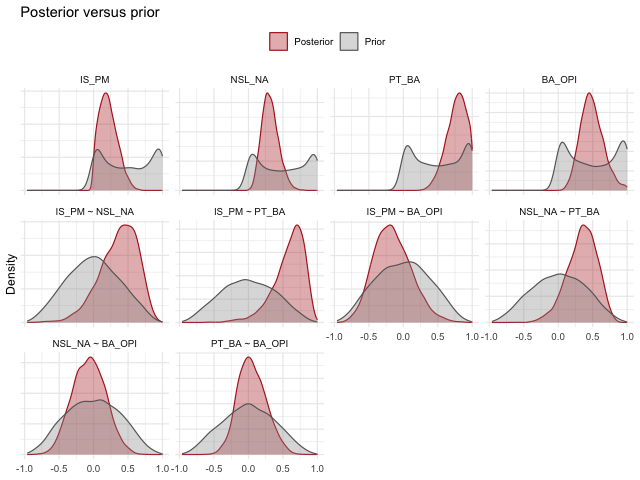
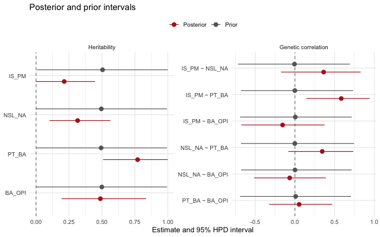
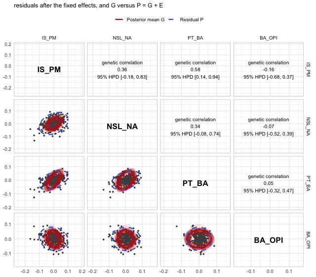
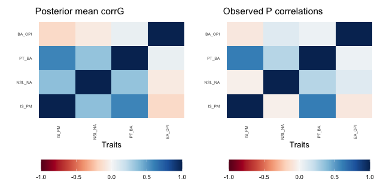

`ratones_morpho` ships with the package (Penna et al. 2017): 35 cranial
distances for 329 mice from five artificial selection lines, with sex, age,
generation and line. This vignette fits four of the distances, with the
relationship matrix built by `animal_design()` from the dam and sire recorded on
each mouse, and then fits the same model in size and shape coordinates.


``` r
library(stanimal)
library(patchwork)
```

## Data


``` r
dat <- ratones_morpho
table(dat$selection)
#> 
#>   control downwards   upwards 
#>        67       121       141
```

Four distances spanning the skull, on the log scale as usual for morphometrics.
The 35 distances are moderately integrated (one principal component explains
about 40% of the variance), so a handful of them already carry a correlated
genetic signal.


``` r
traits <- c("IS_PM", "NSL_NA", "PT_BA", "BA_OPI")
dat[traits] <- log(dat[traits])
round(cor(dat[traits]), 2)
#>        IS_PM NSL_NA PT_BA BA_OPI
#> IS_PM   1.00  -0.04  0.61  -0.08
#> NSL_NA -0.04   1.00  0.25   0.10
#> PT_BA   0.61   0.25  1.00   0.04
#> BA_OPI -0.08   0.10  0.04   1.00
```

`animal_design()` builds `Y`, `X` and `A` in one call. The formula gives the
fixed effects: sex, age at death and selection line (the lines differ in body
weight by construction, so their means must be modelled). `pedigree = ped` adds
the relationship matrix. The rows of `ratones_morpho` are named with the
individual IDs, so the pedigree is matched to the rows of `Y` automatically, and
parents without records are added as founders.


``` r
ped <- ratones_pedigree
design <- suppressWarnings(
  animal_design(cbind(IS_PM, NSL_NA, PT_BA, BA_OPI) ~ SEX + AGE + LIN,
                dat, pedigree = ped))
dim(design$Y)
#> [1] 329   4
colnames(design$X)
#> [1] "(Intercept)" "SEXM"        "AGE"         "LINhp"       "LINs"       
#> [6] "LINsp"       "LINt"
dim(design$A)
#> [1] 329 329
```

## Fit


``` r
fit <- lmm_animal(design$Y, design$X, design$A, lkj_prior = 2,
                  iter = 3000, warmup = 1500, chains = 4, cores = 4,
                  refresh = 0, seed = 1)
#> Running MCMC with 4 parallel chains...
#> Chain 1 finished in 29.3 seconds.
#> Chain 4 finished in 30.7 seconds.
#> Chain 2 finished in 32.4 seconds.
#> Chain 3 finished in 37.9 seconds.
#> 
#> All 4 chains finished successfully.
#> Mean chain execution time: 32.6 seconds.
#> Total execution time: 38.1 seconds.
fit$summary(c("h2", "sigma_G", "sigma_E", "corrG"))
#> # A tibble: 28 × 10
#>    variable   mean median      sd     mad      q5    q95  rhat ess_bulk ess_tail
#>    <chr>     <dbl>  <dbl>   <dbl>   <dbl>   <dbl>  <dbl> <dbl>    <dbl>    <dbl>
#>  1 h2[1]    0.214  0.200  0.129   0.136   0.0267  0.448   1.00    1683.    1736.
#>  2 h2[2]    0.316  0.307  0.120   0.119   0.132   0.531   1.00    2747.    3357.
#>  3 h2[3]    0.771  0.787  0.144   0.151   0.508   0.980   1.00    1613.    1362.
#>  4 h2[4]    0.488  0.474  0.165   0.162   0.238   0.785   1.00    2839.    1634.
#>  5 sigma_G… 0.0189 0.0190 0.00706 0.00700 0.00681 0.0303  1.00    1701.    1773.
#>  6 sigma_G… 0.0204 0.0203 0.00461 0.00447 0.0131  0.0282  1.00    2831.    3400.
#>  7 sigma_G… 0.0279 0.0281 0.00393 0.00409 0.0210  0.0339  1.00    1832.    2687.
#>  8 sigma_G… 0.0244 0.0241 0.00535 0.00507 0.0162  0.0339  1.00    2794.    1770.
#>  9 sigma_E… 0.0379 0.0381 0.00288 0.00285 0.0330  0.0424  1.00    2305.    3137.
#> 10 sigma_E… 0.0303 0.0304 0.00246 0.00234 0.0261  0.0342  1.00    3271.    3507.
#> # ℹ 18 more rows
fit$diagnostic_summary()
#> $num_divergent
#> [1] 0 0 0 0
#> 
#> $num_max_treedepth
#> [1] 0 0 0 0
#> 
#> $ebfmi
#> [1] 0.9044426 0.8073316 0.8905995 0.9236855
```

The fixed effects, named after the columns of `X`:


``` r
beta_draws <- rename_beta(fit, "beta")
posterior::summarise_draws(beta_draws)
#> # A tibble: 28 × 10
#>    variable       mean   median      sd     mad       q5      q95  rhat ess_bulk
#>    <chr>         <dbl>    <dbl>   <dbl>   <dbl>    <dbl>    <dbl> <dbl>    <dbl>
#>  1 beta[1,(I…  1.42e+0  1.42e+0 1.41e-2 1.41e-2  1.40e+0  1.45e+0 1.00     3575.
#>  2 beta[2,(I…  2.10e+0  2.10e+0 1.29e-2 1.26e-2  2.08e+0  2.12e+0 1.00     3952.
#>  3 beta[3,(I…  2.36e+0  2.36e+0 1.19e-2 1.20e-2  2.34e+0  2.38e+0 1.00     2833.
#>  4 beta[4,(I…  1.43e+0  1.43e+0 1.26e-2 1.26e-2  1.41e+0  1.45e+0 1.00     4434.
#>  5 beta[1,SE… -4.16e-3 -4.23e-3 4.64e-3 4.68e-3 -1.17e-2  3.48e-3 1.00     6271.
#>  6 beta[2,SE…  6.59e-3  6.60e-3 3.84e-3 3.79e-3  1.84e-4  1.30e-2 1.00     7151.
#>  7 beta[3,SE…  2.70e-3  2.69e-3 2.90e-3 2.91e-3 -2.09e-3  7.46e-3 1.00     6337.
#>  8 beta[4,SE… -6.42e-3 -6.45e-3 3.43e-3 3.38e-3 -1.20e-2 -6.95e-4 1.000    8904.
#>  9 beta[1,AG…  5.13e-4  5.12e-4 8.08e-5 8.13e-5  3.84e-4  6.48e-4 1.000    6685.
#> 10 beta[2,AG…  5.18e-4  5.18e-4 6.88e-5 6.71e-5  4.03e-4  6.32e-4 1.00     7358.
#> # ℹ 18 more rows
#> # ℹ 1 more variable: ess_tail <dbl>
```

The traits are log distances, so variances are small numbers; heritabilities and
correlations are scale free and easier to read.


``` r
signif(draws_mean(fit, "G"), 2)
#>           IS_PM   NSL_NA   PT_BA   BA_OPI
#> IS_PM   4.1e-04  1.6e-04 3.4e-04 -8.7e-05
#> NSL_NA  1.6e-04  4.4e-04 2.1e-04 -3.3e-05
#> PT_BA   3.4e-04  2.1e-04 7.9e-04  2.5e-05
#> BA_OPI -8.7e-05 -3.3e-05 2.5e-05  6.3e-04
round(draws_mean(fit, "corrG"), 2)
#>        IS_PM NSL_NA PT_BA BA_OPI
#> IS_PM   1.00   0.36  0.58  -0.16
#> NSL_NA  0.36   1.00  0.34  -0.07
#> PT_BA   0.58   0.34  1.00   0.05
#> BA_OPI -0.16  -0.07  0.05   1.00
```

`P = G + E` is estimated after the fixed effects, so it is smaller than the raw
covariance of the traits, which also contains the sex, age and line effects. It
is close to the covariance of the least-squares residuals:


``` r
signif(draws_mean(fit, "P"), 2)
#>           IS_PM   NSL_NA    PT_BA   BA_OPI
#> IS_PM   0.00190  5.0e-04  6.1e-04 -2.2e-04
#> NSL_NA  0.00050  1.4e-03  3.9e-04 -2.9e-05
#> PT_BA   0.00061  3.9e-04  1.0e-03 -5.8e-05
#> BA_OPI -0.00022 -2.9e-05 -5.8e-05  1.2e-03
signif(cov(residuals(lm(cbind(IS_PM, NSL_NA, PT_BA, BA_OPI) ~ SEX + AGE + LIN,
                        dat))), 2)
#>           IS_PM   NSL_NA    PT_BA   BA_OPI
#> IS_PM   0.00170  4.9e-04  0.00056 -2.1e-04
#> NSL_NA  0.00049  1.3e-03  0.00037 -3.5e-05
#> PT_BA   0.00056  3.7e-04  0.00080 -6.0e-05
#> BA_OPI -0.00021 -3.5e-05 -0.00006  1.1e-03
```

## Plots

Where the prior and the posterior overlap for h2 and `corrG`, the data add
little information.


``` r
plot_prior_posterior(fit, trait_names = traits, ncol = 4)
```

<div class="figure">

<p class="caption">plot of chunk prior-posterior</p>
</div>


``` r
plot_forest(fit, trait_names = traits)
```

<div class="figure">

<p class="caption">plot of chunk forest</p>
</div>

The residuals after the fixed effects, with posterior draws of the `G` ellipses
and the genetic correlations. `X = design$X` removes the sex, age and line
effects, so the cloud and the dashed ellipse have roughly the covariance
`P = G + E`.


``` r
plot_G_ellipses(fit, design$Y, trait_names = traits, n_show = 100,
                X = design$X)
```

<div class="figure">

<p class="caption">plot of chunk ellipses</p>
</div>


``` r
plot_corr(draws_mean(fit, "corrG"), "Posterior mean corrG") +
  plot_corr(cor(dat[traits]), "Observed P correlations")
```

<div class="figure">

<p class="caption">plot of chunk corr</p>
</div>

## The same model in size and shape coordinates

Size plus the three shape axes span the same space as the four traits, so this
is the same model in another parametrisation: same number of traits, same `X`
and `A`. The prior is not invariant, though: the LKJ prior now acts on
correlations between size and shape rather than between the raw traits, and the
shape axes are principal components, so their correlations are expected to be
small. `lkj_prior` stays at 2 to keep the two fits comparable.


``` r
ss <- size_shape(dat[traits], n_shape = length(traits) - 1L)
dat_ss <- cbind(dat, ss$scores)
design_ss <- suppressWarnings(
  animal_design(cbind(size, shape1, shape2, shape3) ~ SEX + AGE + LIN,
                dat_ss, pedigree = ped))
fit_ss <- lmm_animal(design_ss$Y, design_ss$X, design_ss$A, lkj_prior = 2,
                     iter = 3000, warmup = 1500, chains = 4, cores = 4,
                     refresh = 0, seed = 1)
#> Running MCMC with 4 parallel chains...
#> Chain 1 finished in 23.1 seconds.
#> Chain 2 finished in 23.6 seconds.
#> Chain 3 finished in 24.1 seconds.
#> Chain 4 finished in 24.9 seconds.
#> 
#> All 4 chains finished successfully.
#> Mean chain execution time: 24.0 seconds.
#> Total execution time: 25.1 seconds.
```

`back_transform()` maps every draw back to the measured traits, returning `G` as
a traits by traits by draws array named after the traits.


``` r
post_ss <- back_transform(fit_ss, ss)
G_traits <- draws_mean(fit, "G")
G_size_shape <- draws_mean(post_ss, "G")
round(G_traits, 4)
#>         IS_PM NSL_NA PT_BA BA_OPI
#> IS_PM   4e-04  2e-04 3e-04 -1e-04
#> NSL_NA  2e-04  4e-04 2e-04  0e+00
#> PT_BA   3e-04  2e-04 8e-04  0e+00
#> BA_OPI -1e-04  0e+00 0e+00  6e-04
round(G_size_shape, 4)
#>        IS_PM NSL_NA PT_BA BA_OPI
#> IS_PM  4e-04  3e-04 3e-04  0e+00
#> NSL_NA 3e-04  5e-04 2e-04  0e+00
#> PT_BA  3e-04  2e-04 7e-04  1e-04
#> BA_OPI 0e+00  0e+00 1e-04  6e-04
# largest difference, relative to the largest element of G
round(max(abs(G_traits - G_size_shape)) / max(abs(G_traits)), 3)
#> [1] 0.167
```

The two fits are to linear maps of the same data, so `fit_loo()` can compare them
on the trait scale once it is told the transformation:


``` r
loo::loo_compare(list(raw = fit_loo(fit),
                      size_shape = fit_loo(fit_ss, transform = ss)))
#>       model elpd_diff se_diff p_worse       diag_diff diag_elpd
#>         raw       0.0     0.0      NA                          
#>  size_shape      -1.3     1.6    0.79 |elpd_diff| < 4
#> 
#> Diagnostic flags present.
#> See ?`loo-glossary` (sections `diag_diff` and `diag_elpd`)
#> or https://mc-stan.org/loo/reference/loo-glossary.html.
```

The difference is well inside two standard errors, so the data do not prefer
one parametrisation: they are the same model under slightly different priors.
